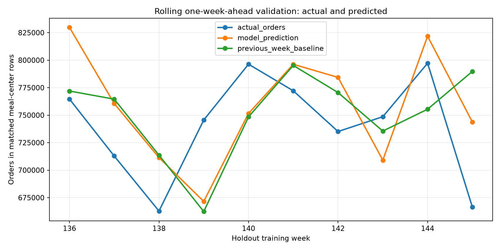
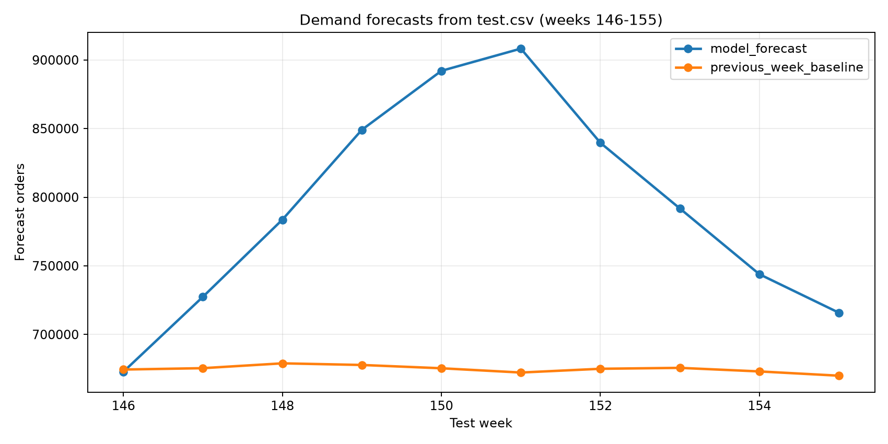

# التنبؤ بالطلب واستخدامه في التخطيط للشراء

## الخلاصة

استُخدم انحدار خطي للتنبؤ بطلب كل زوج (مركز، وجبة) أسبوعيًا. في التقييم الزمني المتحرك على الأسابيع **136–145**، بلغ MAE للنموذج **93.31 طلبًا لكل سجل**، مقابل **81.78** لخط أساس طلب الأسبوع السابق. أي إن MAE للنموذج أعلى بنحو **14.10%**؛ لذلك لا تدعم النتائج استخدام الانحدار الخطي بدل خط الأساس حاليًا.

مع ذلك، أُعيد تدريب النموذج على كامل التدريب حتى الأسبوع **145**، واستُخدم ملف `test.csv` لإنتاج تنبؤ لكل سجل من سجلات الأسابيع **146–155**. مجموع التنبؤات النموذجية لهذه السجلات هو **7,924,255 طلبًا** تقريبًا، مقابل **6,747,755** لخط الأساس التكراري. هذان الرقمان توقعان للفترة، وليسا طلبات فعلية أو تقديرًا مؤكدًا لما يجب شراؤه.

## التقييم الزمني

- **التدريب:** بيانات التدريب حتى الأسبوع 135.
- **التحقق:** الأسابيع 136–145، بتنبؤ أسبوع واحد إلى الأمام في كل مرة. بعد مقارنة الأسبوع، تُستخدم قيمه الفعلية كمدخل للأسبوع التالي؛ لذلك فهذا تقييم متحرك، وليس تنبؤًا ثابتًا بعشرة أسابيع دفعة واحدة.
- **النموذج:** Linear Regression بخصائص الأسبوع، المركز والوجبة، السعرين، مؤشري الترويج، وطلب الزوج نفسه في الأسبوع السابق. قُصّت التنبؤات السالبة إلى صفر.
- **خط الأساس:** طلب الأسبوع السابق للزوج نفسه.
- **المقياس:** MAE بوحدة الطلبات لكل سجل وجبة-مركز-أسبوع. حُسبت المقارنة للطريقتين على الصفوف نفسها فقط عندما وجد سجل فعلي للزوج نفسه في الأسبوع السابق.

| المقياس | انحدار خطي | طلب الأسبوع السابق |
|---|---:|---:|
| MAE للأسابيع 136–145 | 93.31 | 81.78 |
| الصفوف المقيمة | 31,245 | 31,245 |
| نسبة التحسن مقابل خط الأساس | −14.10% | — |

من أصل **32,821** سجل تحقق، أمكن تقييم **31,245** (95.20%). لم تتوفر مشاهدة للأسبوع السابق لـ **1,576** سجلًا؛ استُبعدت هذه السجلات من مقارنة MAE بدل افتراض أن طلبها صفر. وفي تكوين بيانات تدريب النموذج، احتفظ ربط الإبطاء الأسبوعي بـ **431,447** من أصل **456,548** سجلًا، ولم تتوفر مطابقة أسبوع سابق بالزوج نفسه لـ **25,101** سجلًا؛ لم تُعامل تلك الحالات كصفر.

يعرض الرسم المجاميع الأسبوعية للسجلات الداخلة في التقييم ذي الإبطاء المتاح فقط؛ أما مقياس MAE في الجدول فهو محسوب على مستوى السجل.

## تنبؤات ملف الاختبار

استُخدمت قيم السعر ومؤشرا الترويج المتاحة في `test.csv` كمدخلات، مع تدريب النموذج على بيانات التدريب حتى الأسبوع 145. في الأسابيع المستقبلية تُمرّر تنبؤات النموذج إلى سجلات الأسابيع التالية؛ ويُنشأ خط الأساس كل مرة بترحيل طلب الأسبوع السابق أو توقعه. لذلك يتراكم عدم اليقين مع امتداد الأفق.

| الأسبوع | سجلات الاختبار | مجموع الانحدار الخطي | مجموع خط الأساس السابق |
|---:|---:|---:|---:|
| 146 | 3,240 | 672,777 | 674,419 |
| 147 | 3,271 | 727,388 | 675,426 |
| 148 | 3,332 | 783,606 | 678,945 |
| 149 | 3,313 | 849,091 | 677,754 |
| 150 | 3,277 | 892,056 | 675,355 |
| 151 | 3,224 | 908,253 | 672,244 |
| 152 | 3,242 | 839,628 | 674,978 |
| 153 | 3,268 | 791,771 | 675,649 |
| 154 | 3,228 | 743,861 | 673,046 |
| 155 | 3,178 | 715,825 | 669,939 |
| **الإجمالي** | **32,573** | **7,924,255** | **6,747,755** |

أُنتج تنبؤ لكل واحد من سجلات الاختبار البالغ عددها **32,573**. في **30,924** سجلًا توفر طلب الزوج نفسه من الأسبوع السابق؛ وفي **1,646** سجلًا استُخدمت آخر مشاهدة تاريخية متاحة للزوج بدل اعتبار عدم وجود سجل طلبًا صفريًا؛ وثلاثة سجلات بلا تاريخ سابق للزوج استخدمت وسيط طلب الوجبة في التدريب. توضح هذه البدائل سبب الحذر في قراءة بعض التنبؤات.

## كيف يستخدم العميل النتائج في الشراء؟

1. **ابدأ بخط الأساس كمرجع تخطيط أساسي**، لأن MAE لديه أقل من MAE الانحدار في فترة التحقق. احتفظ بتنبؤ الانحدار كإشارة إضافية للمراجعة، لا كبديل مثبت الدقة.
2. **خطّط أسبوعيًا حسب الوجبة والمركز** من ملف [تنبؤات سجلات الاختبار](test_demand_forecast.csv)، وراجع الفروق بين التنبؤ النموذجي وخط الأساس قبل اعتماد الكميات.
3. **حوّل الطلب المتوقع إلى احتياج مواد فقط بعد إضافة بيانات الوصفة والمخزون:** لكل مادة، احتياج الفترة = مجموع (توقع طلب الوجبة × كمية المادة للوحدة) مع مراعاة مردود التحضير؛ ثم اطرح المخزون المتاح والكميات الواردة، وأضف مخزون الأمان وفق مهلة التوريد ومستوى الخدمة.
4. **حدّث الخطة عند ورود الطلب الفعلي** كل أسبوع؛ فتقييم النموذج كان متحركًا أسبوعًا واحدًا، أما التنبؤ لعشرة أسابيع متتالية فيستخدم قيمًا متوقعة بدل الفعلية بدءًا من الأسبوع الثاني.

لا يمكن تحويل توقعات الطلب إلى أمر شراء للمكونات من هذه الملفات وحدها: لا توجد وصفات أو كميات مواد لكل وجبة، أو أرصدة مخزون، أو توريدات قيد الوصول، أو مهلة توريد، أو معدلات هدر. كما لا يثبت MAE وحده مستوى توافر مخزون أو ربحية محددًا.

## مصدر الأرقام والملفات

- خطوات التحميل والتحقق والإنشاء وإعادة التشغيل: [سكريبت التنبؤ](../../scripts/forecast_demand.py).
- خلية دفتر التحليل التي تشغّل التنبؤ: [دفتر التحليل](../../notebooks/analysis.ipynb)، القسم **التنبؤ بالأسابيع 146–155 والتحقق الزمني**.
- تفاصيل MAE الأسبوعية: [forecast_validation_metrics.csv](forecast_validation_metrics.csv).
- المجاميع الأسبوعية للأسابيع 146–155: [test_weekly_forecast_summary.csv](test_weekly_forecast_summary.csv).
- تنبؤات كل سجل في `test.csv`: [test_demand_forecast.csv](test_demand_forecast.csv).
- ملخص المقاييس والتغطية: [forecast_metrics.json](forecast_metrics.json).
- الرسمان: [التحقق الزمني](forecast_validation.png) و[التنبؤ للأسابيع 146–155](forecast_test_weeks.png).

## الحدود

- لا توجد تواريخ تقويمية حقيقية؛ الفترة موصوفة بأرقام الأسابيع فقط.
- `num_orders` غير موجود في `test.csv`؛ لذلك لا يمكن حساب MAE أو التحقق من تنبؤات الأسابيع 146–155 قبل توفر الطلب الفعلي.
- التنبؤ مشروط بوجود قيم السعر والترويج الموجودة في `test.csv`؛ أي اختلاف عن القيم الفعلية أو المخططة يغيّر النتيجة.
- MAE متوسط مطلق للخطأ ولا يبيّن وحده اتجاه الانحياز أو مخاطر أسابيع الذروة، ولا يوفر فاصل تنبؤ.
- نتائج التدريب رصدية، ولا تثبت أن الأسعار أو العروض تسبب تغير الطلب.
- التنبؤ بالطلب لا يساوي مباشرةً كمية المشتريات؛ يلزم ربطه بالوصفات والمخزون والهدر ومهلة التوريد.
